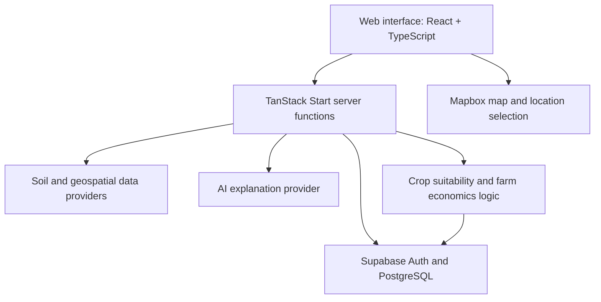

<div align="center">

# ZaminAI

### Data-driven agricultural decision support for Uzbekistan

**Land insights · Crop suitability screening · Farm economics**

[Live application](https://zaminai.tech) · [Source code](https://github.com/MuhammadaminAR/ZaminAI)

</div>

---

## Overview

ZaminAI is a production web application designed to help users explore soil-related information, compare preliminary crop suitability, and structure basic farm-economics calculations. It brings geospatial data, rule-based analysis, and AI-generated explanations into one workflow.

The project combines software engineering with economic decision support: the goal is not only to display data, but to make assumptions, uncertainty, and trade-offs easier to understand.

> **Important:** ZaminAI is an early-stage decision-support tool, not a substitute for laboratory soil testing, local agronomic advice, or a full farm business plan. Suitability scores are preliminary, and they should not be interpreted as yield predictions or guaranteed profitability.

## Core capabilities

- **Land and soil exploration** — select a location on a map and retrieve available soil information.
- **Preliminary crop suitability** — compare crop profiles using the soil factors currently supported by the scoring rules. Missing or unsupported inputs are treated as uncertainty rather than silently presented as verified measurements.
- **Farm economics** — estimate financial outcomes using entered assumptions about revenue and costs. Outputs depend on the quality of the input values.
- **AI agronomy explanations** — explain an assessment in natural language using a server-side model integration. Explanations should be checked against the underlying data and the tool's stated limitations.
- **Historical climate exploration** — display prepared historical rainfall summaries where validated data are available. The current pilot coverage is limited; it should not be described as nationwide climate coverage.
- **User accounts and saved analyses** — Supabase Auth and database-backed storage support the application's account and analysis workflow.

## Technical architecture



The diagram shows the main logical components; exact provider calls and runtime configuration depend on the enabled features and environment.

## Technology stack

- **Frontend:** React, TypeScript, TanStack Start, TanStack Router
- **UI:** Tailwind CSS, Radix UI, Lucide, Recharts
- **Data and authentication:** Supabase, PostgreSQL, Row Level Security (RLS)
- **Maps:** Mapbox GL JS
- **Analysis:** TypeScript scoring modules, crop profiles, economic calculation utilities
- **AI:** server-side Gemini integration
- **Build and tests:** Vite, Vitest, ESLint, TypeScript

## Repository structure

```text
src/
├── components/             # Application UI and reusable components
├── integrations/supabase/  # Supabase clients, authentication and database types
├── lib/                    # Domain logic, scoring, economics, maps and data providers
├── routes/                 # Application pages and route handlers
└── routeTree.gen.ts        # Generated TanStack Router route tree
drizzle/migrations/         # Database schema and policy migrations
scripts/                    # Data preparation/import utilities and tests
```

## Getting started

### Requirements

- Node.js (a current LTS version is recommended)
- A Supabase project with the required schema and policies
- A Mapbox public token for the map interface
- Optional provider credentials for the AI or other provider-backed features you enable

### Local setup

1. Clone this repository and install dependencies:

   ```bash
   git clone https://github.com/MuhammadaminAR/ZaminAI.git
   cd ZaminAI
   npm install
   ```

2. Create your local environment file:

   ```bash
   cp .env.example .env
   ```

3. Fill in the values for **your own** Supabase project, Mapbox token and any server-side providers you configure. Never commit `.env` or put server-only credentials in a variable prefixed with `VITE_`.

4. Configure Supabase Auth. Enable Google as a provider if needed, and allow the local callback URL (`http://localhost:3000/auth/callback`) and your deployed callback URL in the Supabase Auth URL configuration. Configure the matching Google OAuth redirect URI in the provider console.

5. Apply the database migrations to a **separate development Supabase project** after reviewing them. Do not point a fresh clone at the production database.

6. Start the development server:

   ```bash
   npm run dev
   ```

   Open the local URL printed by Vite.

### Build and checks

```bash
npm run typecheck
npm run test
npm run lint
npm run build
```

Provider-backed features need valid credentials and the appropriate service-side configuration. A successful local build alone does not verify live API access, authentication-provider setup, or the accuracy of agronomic recommendations.

## Methodology and limitations

- Soil grid estimates are not equivalent to field sampling or laboratory measurements.
- The crop scoring logic only weights factors for which the current rules are defined; missing data and unsupported factors limit confidence.
- Crop suitability is not the same as expected yield or financial return.
- Economic calculations are estimates based on user-entered assumptions; price, yield, irrigation, labor, input costs, and market volatility can materially change the result.
- Historical climate summaries are available only for prepared cells and validated periods. Current pilot coverage is not nationwide.
- AI-generated explanations can be incomplete or incorrect and should not override source data or expert judgment.

## Data sources and attribution

The project integrates third-party services and datasets, including soil, mapping, weather/climate, and AI providers. Before deploying a fork, review each provider's current terms, rate limits, attribution rules, and credential requirements. Retain any applicable source citations and licence requirements when reusing prepared data.

## Security notes

- Never commit `.env`, access tokens, database passwords, Supabase service-role keys, or provider secrets.
- Keep service-role credentials server-side only; use public/publishable keys in the browser.
- Apply and review Row Level Security policies before using real user data.
- Use a separate development database for forks and tests.
- Restrict public map tokens to the intended website origins where the provider supports it.

## Licence

This project is licensed under the MIT License.
See [LICENSE](./LICENSE) for details. Third-party dependencies,
datasets, and external services may have separate licence
and attribution requirements.
